# NPTEL Ethical Hacking — Week 0 Comprehensive Synthesis & Revision Notes

**Course**: NPTEL Ethical Hacking  
**Instructor**: Prof. Indranil Sen Gupta, Department of Computer Science and Engineering, IIT Kharagpur  
**Document Type**: Synthesis, Master Revision Notes, Comparison Tables, and Audit Sheet  
**Coverage**: Assignment 0 (Questions 1–12) & Lecture 1–5 Prerequisites  
**Target File**: `revision-notes/week-00-revision.md`  

---

## Table of Contents
1. [Section A: Topic Map](#section-a-topic-map)
2. [Section B: Consolidated Comparison Tables](#section-b-consolidated-comparison-tables)
   - [Table 1: Internetworking Devices Comparison](#table-1-internetworking-devices-comparison)
   - [Table 2: Core Protocols Comparison](#table-2-core-protocols-comparison)
   - [Table 3: OSI 7-Layer Reference Model Complete Reference](#table-3-osi-7-layer-reference-model-complete-reference)
   - [Table 4: TCP/IP 4-Layer vs. OSI 7-Layer Architecture Mapping](#table-4-tcpip-4-layer-vs-osi-7-layer-architecture-mapping)
   - [Table 5: Well-Known Port Numbers & Protocols](#table-5-well-known-port-numbers--protocols)
   - [Table 6: IPv4 vs. IPv6 Deep Comparison](#table-6-ipv4-vs-ipv6-deep-comparison)
   - [Table 7: Defensive Security Tools vs. Offensive Threats & Malware](#table-7-defensive-security-tools-vs-offensive-threats--malware)
   - [Table 8: Circuit Switching vs. Packet Switching](#table-8-circuit-switching-vs-packet-switching)
   - [Table 9: Virtual Circuit vs. Datagram Packet Switching](#table-9-virtual-circuit-vs-datagram-packet-switching)
   - [Table 10: Penetration Testing Models (White vs. Black vs. Gray Box)](#table-10-penetration-testing-models-white-vs-black-vs-gray-box)
3. [Section C: Master Revision Notes](#section-c-master-revision-notes)
   - [Module 1: Ethical Hacking Foundations, Roles & Methodologies](#module-1-ethical-hacking-foundations-roles--methodologies)
   - [Module 2: Network Scopes & Switching Fundamentals](#module-2-network-scopes--switching-fundamentals)
   - [Module 3: Internetworking Devices & Hardware Layering](#module-3-internetworking-devices--hardware-layering)
   - [Module 4: Layered Architectures (OSI 7-Layer vs. TCP/IP 4-Layer)](#module-4-layered-architectures-osi-7-layer-vs-tcpip-4-layer)
   - [Module 5: Transport Layer & Core Application Protocols](#module-5-transport-layer--core-application-protocols)
   - [Module 6: Network Addressing (IPv4, IPv6) & IPv4 Header Architecture](#module-6-network-addressing-ipv4-ipv6--ipv4-header-architecture)
   - [Module 7: Linux Network Utilities vs. Host Commands](#module-7-linux-network-utilities-vs-host-commands)
4. [Section D: Memory Aids & Mnemonics](#section-d-memory-aids--mnemonics)
5. [Section E: Formula & Command Sheet](#section-e-formula--command-sheet)
6. [Section F: Coverage Audit (Q1–Q12)](#section-f-coverage-audit-q1q12)
7. [Section G: Weekly Progress Record](#section-g-weekly-progress-record)

---

# Section A: Topic Map

The Week 0 curriculum establishes the foundational pillars required for ethical hacking, penetration testing, network defense, and vulnerability analysis. The 12 assignment questions and 5 lectures map into six coherent thematic clusters.

```mermaid
graph TD
    EH[Week 0: Ethical Hacking & Networking Fundamentals]
    
    %% Main Clusters
    EH --> M1[Module 1: Security & Ethical Hacking]
    EH --> M2[Module 2: Network Types & Switching]
    EH --> M3[Module 3: Internetworking Devices]
    EH --> M4[Module 4: Layered Architectures]
    EH --> M5[Module 5: Protocols & Ports]
    EH --> M6[Module 6: Addressing & CLI Tools]
    
    %% Module 1 Details
    M1 --> Q1[Q1: Ethical vs Malicious Hacking]
    M1 --> Q2[Q2: Antivirus & Firewall vs Malware]
    M1 --> M1_Lec[Pen-Test Models: Black/White/Gray Box, Tiger Box]
    
    %% Module 2 Details
    M2 --> Q3[Q3: LAN Scope & Definition]
    M2 --> M2_Lec[Circuit vs Packet Switching, Virtual Circuit vs Datagram]
    
    %% Module 3 Details
    M3 --> Q4[Q4: Router vs Switch vs Hub vs Repeater]
    M3 --> M3_Lec[Collision & Broadcast Domains, L2 vs L3 Devices]
    
    %% Module 4 Details
    M4 --> Q7[Q7: OSI 7-Layer Model Count]
    M4 --> Q9[Q9: Reliable Transmission Layer - Transport]
    M4 --> M4_Lec[OSI vs TCP/IP 4-Layer Architecture & PDUs]
    
    %% Module 5 Details
    M5 --> Q5[Q5: Email Protocol - SMTP]
    M5 --> Q8[Q8: Transport Layer - TCP & UDP]
    M5 --> Q10[Q10: HTTP Default Port - 80]
    
    %% Module 6 Details
    M6 --> Q6[Q6: Linux CLI - ifconfig vs ipconfig]
    M6 --> Q11[Q11: IPv4 Octet Validation 0-255]
    M6 --> Q12[Q12: IPv6 Bit Length - 128 bits]
    M6 --> M6_Lec[IP Datagram Header, HLEN, TTL, Checksum]
```



### 1. Conceptual Breakdown of Questions

| Question | Core Concept | Subtopic | Primary Focus | Lecture Reference |
| :--- | :--- | :--- | :--- | :--- |
| **Q1** | Ethical Hacking Definition | Legal Authorization & Red Teaming | Penetration testing on owner's behalf | Lecture 1 (Slides 3–14) |
| **Q2** | Defensive Applications | Host Security Mechanisms | Antivirus & Firewall vs. Virus & Malware | Lecture 1 (Slides 6–7, 13) |
| **Q3** | Network Classification | Geographic Network Spans | Local Area Network (LAN) vs. WAN | Lecture 2 (Slides 3–4) |
| **Q4** | Network Devices | Internetworking & Heterogeneity | Router connecting disparate networks | Lecture 3 (Slides 15–16) |
| **Q5** | Application Protocols | Electronic Mail Delivery | SMTP (Simple Mail Transfer Protocol) | Lecture 4 (Slides 7–8) |
| **Q6** | Operating System Utilities | Linux Network Diagnostics | `ifconfig` vs. Windows `ipconfig` | Lecture 5 (Slide 11) & CLI Lab |
| **Q7** | Reference Models | Architectural Layering | 7 Layers of the ISO-OSI Reference Model | Lecture 3 (Slides 10–14) |
| **Q8** | Transport Protocols | Layer 4 Protocol Suite | TCP and UDP identification | Lecture 4 (Slides 8, 12–13) |
| **Q9** | Reliable Data Delivery | End-to-End Reliability | Transport Layer error recovery & flow control | Lecture 3 (Slide 13) & Lec 4 (Slide 12) |
| **Q10** | Port Addressing | Well-Known Service Ports | HTTP on Port 80 | Lecture 4 (Slide 14) & RFC 1700 |
| **Q11** | Logical Addressing | IPv4 Dot-Decimal Range | Octet bounds ($0 \le x \le 255$) | Lecture 5 (Slides 4–9) |
| **Q12** | Next-Gen Addressing | IPv6 Structural Bit-Length | 128-bit address representation | Lecture 4 (Slide 14) & RFC 8200 |

### 2. Prerequisites
- **Binary & Modular Arithmetic**: Understanding powers of 2 ($2^8 = 256$, $2^{16} = 65,536$, $2^{32} \approx 4.29 \times 10^9$, $2^{128} \approx 3.4 \times 10^{38}$).
- **Client-Server Architecture**: Understanding how a client process binds to an ephemeral source port and communicates with a well-known destination port on a remote server.
- **Hierarchical Layering**: Understanding why communication tasks are split into modular abstractions so that changes in lower layers (e.g., swapping Copper for Optical Fiber) do not require changes in higher layers (e.g., HTTP).
- **Basic Shell Navigation**: Distinguishing between POSIX-compliant shells (Bash/Linux) and Windows Command Shell (cmd.exe/PowerShell).

### 3. Repeated & Central Concepts
- **End-to-End vs. Hop-to-Hop Responsibility**: Transport layer (Layer 4) guarantees end-to-end message integrity between sender and receiver processes; Data Link layer (Layer 2) only guarantees point-to-point hop integrity across a single physical wire/channel.
- **Connection-Oriented vs. Connectionless Delivery**:
  - Connection-Oriented: Circuit switching, Virtual Circuits, TCP (state maintained, handshakes, pipelining).
  - Connectionless: Datagram packet switching, UDP, IP (no setup delay, independent packets, no history maintained).
- **Three-Tier Addressing Model**:
  - Hardware/Physical Address: MAC address (48 bits / 6 bytes) at Layer 2.
  - Logical/Network Address: IPv4 (32 bits / 4 bytes) or IPv6 (128 bits / 16 bytes) at Layer 3.
  - Process/Port Address: Port number (16 bits / 2 bytes) at Layer 4.

### 4. Closely Related Concepts
- **Protocol Data Units (PDUs)** across layers: Bits $\rightarrow$ Frames $\rightarrow$ Packets/Datagrams $\rightarrow$ Segments $\rightarrow$ Data/Messages.
- **Switching vs. Routing**: Layer 2 switching relies on flat physical MAC addresses stored in CAM tables; Layer 3 routing relies on hierarchical logical IP addresses stored in routing tables.
- **Penetration Testing Roles vs. Attacker Profiles**: White Hat (authorized ethical hacker) vs. Black Hat (malicious cracker) vs. Gray Hat (unauthorized but non-malicious disclosure) vs. Script Kiddies (inexperienced operators using pre-built automated scripts).

### 5. Potential Knowledge Gaps & Exam Traps
- Confusing **Transport Layer reliability** (end-to-end, process-to-process) with **Data Link Layer error control** (hop-by-hop, node-to-node).
- Believing `ipconfig` works in Linux (it is strictly a Windows utility; Linux uses `ifconfig` or `ip addr`).
- Assuming IP is reliable because TCP is reliable (IP is inherently unreliable and connectionless; TCP handles retransmissions).
- Overlooking octet overflow in IPv4: numbers like 256 or 296 are invalid because 8 bits can only hold up to 255.
- Conflating **email sending** (SMTP) with **email retrieval** (POP3 / IMAP).

---

# Section B: Consolidated Comparison Tables

## Table 1: Internetworking Devices Comparison

| Device | OSI Layer | Primary PDU Processed | Addressing Scheme Used | Collision Domains | Broadcast Domains | Forwarding / Routing Decision Logic | Key Cybersecurity Implication |
| :--- | :--- | :--- | :--- | :--- | :--- | :--- | :--- |
| **Repeater** | Layer 1 (Physical) | Bits | None (Does not inspect addresses) | Single shared collision domain across all ports | Single broadcast domain | Regenerates and amplifies physical electrical/optical signal | Blindly propagates collision noise and physical eavesdropping |
| **Hub** | Layer 1 (Physical) | Bits | None (Non-intelligent multiport repeater) | Single shared collision domain (1 for all ports) | Single broadcast domain | Floods all incoming bits to every other port | Trivial packet sniffing; any host can capture promiscuous traffic |
| **Bridge** | Layer 2 (Data Link) | Frames | 48-bit MAC Addresses | Isolates collision domains (1 per port) | Single broadcast domain | Inspects Source MAC to learn; forwards based on Destination MAC | Vulnerable to MAC address table flooding (fails open to act like hub) |
| **Switch (Layer 2)** | Layer 2 (Data Link) | Frames | 48-bit MAC Addresses (Hardware CAM table) | Isolates collision domains (1 per port) | Single broadcast domain (without VLANs) | Microsegmentation; point-to-point hardware switching using MAC table | Target for ARP poisoning / spoofing, CAM table exhaustion, VLAN hopping |
| **Router** | Layer 3 (Network) | Packets / Datagrams | 32-bit IPv4 / 128-bit IPv6 (Logical Routing Table) | Isolates collision domains (1 per port) | **Isolates broadcast domains** (Breaks broadcasts) | Inspects Destination IP; uses longest-prefix match routing table | Primary perimeter enforcement: Access Control Lists (ACLs), NAT, IPsec |
| **Layer-3 Switch** | Layer 2 & 3 | Frames & Packets | MAC & IP Addresses (ASIC hardware lookup) | Isolates collision domains | Isolates broadcast domains per VLAN | Inter-VLAN routing at hardware wire speed | High-speed internal core routing; ACL enforcement between internal segments |
| **Gateway** | Layer 4 to 7 | Segments / Messages | Protocol-Specific Headers (Port, App payloads) | Isolated | Isolated | Protocol translation, payload parsing, syntax/semantic mapping | Deep packet inspection (DPI), Application-level proxy firewalls, API security |

---

## Table 2: Core Protocols Comparison

| Protocol | Full Name | Layer (OSI / TCP-IP) | Transport Protocol | Default Port(s) | Connection Paradigm | Reliability Mode | Primary Purpose / Function | Header Overhead |
| :--- | :--- | :--- | :--- | :--- | :--- | :--- | :--- | :--- |
| **TCP** | Transmission Control Protocol | Layer 4 (Transport) | Self (Layer 4) | N/A | Connection-Oriented (3-way handshake) | **Reliable** (ACK, retransmission, sequence #s) | Process-to-process ordered byte-stream delivery | 20–60 bytes |
| **UDP** | User Datagram Protocol | Layer 4 (Transport) | Self (Layer 4) | N/A | Connectionless (No handshake) | **Unreliable** (Best-effort, no ACKs) | Low-latency, minimal overhead datagram delivery | 8 bytes (Fixed) |
| **IP** | Internet Protocol | Layer 3 (Network) | Encapsulates TCP/UDP | N/A | Connectionless (Independent packets) | **Unreliable** (Best-effort, drops packets) | Host-to-host packet routing across internetworks | 20–60 bytes (IPv4) / 40 bytes (IPv6) |
| **SMTP** | Simple Mail Transfer Protocol | Layer 7 (Application) | TCP | 25 (Cleartext MTA) / 587 (Submission) | Connection-Oriented | Reliable (relies on TCP) | Pushing / relaying mail between Mail Transfer Agents | Variable text-based commands |
| **FTP** | File Transfer Protocol | Layer 7 (Application) | TCP | 21 (Control) & 20 (Data) | Connection-Oriented | Reliable (relies on TCP) | Bi-directional interactive file transfer | Variable text commands |
| **HTTP** | Hypertext Transfer Protocol | Layer 7 (Application) | TCP | 80 (Cleartext) | Connection-Oriented | Reliable (relies on TCP) | Request/Response distribution of hypertext resources | Variable ASCII headers |
| **SNMP** | Simple Network Management Protocol | Layer 7 (Application) | UDP | 161 (Polling) / 162 (Traps) | Connectionless | Unreliable (relies on UDP) | Monitoring and managing network devices and metrics | Variable ASN.1 BER encoding |
| **DNS** | Domain Name System | Layer 7 (Application) | UDP (Standard queries) / TCP (Zone transfers) | 53 | Hybrid (UDP primary) | Best-effort on UDP; Reliable on TCP | Resolves human-readable FQDNs to numerical IP addresses | 12 bytes fixed header + records |

---

## Table 3: OSI 7-Layer Reference Model Complete Reference

| Layer # | Layer Name | Primary Function & Responsibilities | Protocol Data Unit (PDU) | Core Protocols / Standards | Associated Hardware / Tools | Addressing Used | End-to-End or Hop-to-Hop? |
| :---: | :--- | :--- | :---: | :--- | :--- | :--- | :---: |
| **7** | **Application** | User interface, network services access, application abstractions | Data / Message | HTTP, HTTPS, SMTP, FTP, DNS, SNMP, SSH, Telnet | Web browsers, Mail clients, APIs | Domain names, URLs, User IDs | End-to-End |
| **6** | **Presentation** | Data formatting, syntax/semantics, encryption/decryption, compression | Data / Message | TLS/SSL, ASCII, Unicode, JPEG, MPEG, MIME | Encryption modules, serializers | N/A (Data formatting syntax) | End-to-End |
| **5** | **Session** | Dialog control, session establishment, token management, synchronization/checkpoints | Data / Message | NetBIOS, RPC, PPTP, SOCKS, NFS | Session managers, operating system sockets | Session IDs, Connection tokens | End-to-End |
| **4** | **Transport** | **Reliable end-to-end data delivery**, error recovery, flow control, segment reassembly | Segment (TCP) / Datagram (UDP) | TCP, UDP, SCTP, QUIC | Firewalls (Stateful), Layer-4 Load Balancers | **Port Address (16 bits)** | **End-to-End** |
| **3** | **Network** | Routing packets across multiple links/networks, logical addressing, fragmentation | Packet / Datagram | IPv4, IPv6, ICMP, IGMP, OSPF, BGP, RIP, IPsec | **Routers**, Layer-3 Switches, Packet sniffers | **Logical IP Address (32 / 128 bits)** | **Hop-to-Hop (Routing)** |
| **2** | **Data Link** | Framing, physical MAC addressing, **hop-by-hop error detection**, flow control | Frame | Ethernet (802.3), Wi-Fi (802.11), PPP, ARP, HDLC | **Layer-2 Switches**, Bridges, NICs | **Physical MAC Address (48 bits)** | **Hop-to-Hop** |
| **1** | **Physical** | Transmission of raw unstructured bit streams over physical transmission medium | Bit | 1000BASE-T, RS-232, RJ-45, V.35, Cat6, Fiber optics | **Hubs**, Repeaters, Modems, Transceivers | Signal levels, Pinouts, Frequencies | **Hop-to-Hop** |

---

## Table 4: TCP/IP 4-Layer vs. OSI 7-Layer Architecture Mapping

```
+------------------------------------+------------------------------------+
|        OSI 7-LAYER MODEL           |       TCP/IP 4-LAYER MODEL         |
+------------------------------------+------------------------------------+
| 7. Application                     |                                    |
| 6. Presentation                    | 4. Application Layer               |
| 5. Session                         |    (User processes, APIs, daemons) |
+------------------------------------+------------------------------------+
| 4. Transport                       | 3. Transport Layer / Host-to-Host  |
|                                    |    (TCP, UDP, SCTP)                |
+------------------------------------+------------------------------------+
| 3. Network                         | 2. Internet / Network Layer        |
|                                    |    (IP, ICMP, IGMP, ARP)           |
+------------------------------------+------------------------------------+
| 2. Data Link                       | 1. Network Access / Link Layer     |
| 1. Physical                        |    (Ethernet, Wi-Fi, Device Driver)|
+------------------------------------+------------------------------------+
```

| TCP/IP Layer Name | OSI Equivalent Layer(s) | Primary Duties | PDU Name | Key Protocols | Addressing Identifier |
| :--- | :--- | :--- | :--- | :--- | :--- |
| **4. Application** | Layers 5, 6, 7 (Session, Presentation, Application) | Direct interface to user processes; handles syntax, encryption, session maintenance, and application data payloads | Message / Data | HTTP, HTTPS, SMTP, FTP, DNS, SNMP, TFTP, SSH | URL, Hostname, Process Name |
| **3. Transport** | Layer 4 (Transport) | Process-to-process communication; segments application messages; provides reliable (TCP) or best-effort (UDP) transfer | Segment / Datagram | TCP, UDP | **Port Number (16-bit)** |
| **2. Internet** | Layer 3 (Network) | Transports datagrams across heterogeneous networks; handles logical routing, addressing, and fragmentation | Datagram / Packet | IPv4, IPv6, ICMP, IGMP, ARP, RARP | **IP Address (32/128-bit)** |
| **1. Network Access (Link)** | Layers 1 & 2 (Physical & Data Link) | Controls physical hardware transmission, network interface drivers, frame transmission, and media access control | Frame / Raw Bits | Ethernet (IEEE 802.3), Wi-Fi (802.11), Frame Relay | **MAC Address (48-bit)** |

---

## Table 5: Well-Known Port Numbers & Protocols

| Port Number | Protocol | Transport Protocol | Service / Description | Security Status | Modern Secure Alternative |
| :---: | :--- | :--- | :--- | :--- | :--- |
| **20** | **FTP-Data** | TCP | File Transfer Protocol (Active Data Channel) | Cleartext | SFTP (Port 22) / FTPS (Port 990) |
| **21** | **FTP-Control** | TCP | File Transfer Protocol (Command Channel) | Cleartext | SFTP (Port 22) / FTPS (Port 989/990) |
| **22** | **SSH / SFTP** | TCP | Secure Shell / Secure File Transfer | **Encrypted** | N/A (Standard secure protocol) |
| **23** | **Telnet** | TCP | Remote Terminal Emulation | **Insecure (Cleartext)** | SSH (Port 22) |
| **25** | **SMTP** | TCP | Simple Mail Transfer Protocol (MTA Relay) | Cleartext | SMTPS (Port 465) / STARTTLS (Port 587) |
| **53** | **DNS** | UDP / TCP | Domain Name System (Name Resolution / Zone Transfer)| Cleartext | DoT (DNS over TLS, Port 853) / DoH (443) |
| **67 / 68** | **DHCP / BOOTP** | UDP | Dynamic Host Configuration (67: Server, 68: Client) | Cleartext | DHCP Snooping / 802.1X Auth |
| **69** | **TFTP** | UDP | Trivial File Transfer Protocol | **Insecure (No Auth)** | SFTP / SCP |
| **80** | **HTTP** | TCP | Hypertext Transfer Protocol (World Wide Web) | **Cleartext** | **HTTPS (Port 443)** |
| **110** | **POP3** | TCP | Post Office Protocol version 3 (Mail Retrieval) | Cleartext | POP3S (Port 995 via TLS) |
| **143** | **IMAP** | TCP | Internet Message Access Protocol (Mail Management) | Cleartext | IMAPS (Port 993 via TLS) |
| **161** | **SNMP-Poll** | UDP | Simple Network Management Protocol (Queries/Agent) | Insecure (v1/v2c) | SNMPv3 (Auth & Privacy encryption) |
| **162** | **SNMP-Trap** | UDP | Simple Network Management Protocol (Trap Alerts) | Insecure (v1/v2c) | SNMPv3 Traps |
| **443** | **HTTPS** | TCP | HTTP over TLS/SSL (Encrypted Web Traffic) | **Encrypted** | Current universal secure web standard |

---

## Table 6: IPv4 vs. IPv6 Deep Comparison

| Characteristic | IPv4 (RFC 791) | IPv6 (RFC 8200) |
| :--- | :--- | :--- |
| **Address Length** | **32 bits** (4 octets / 4 bytes) | **128 bits** (16 octets / 16 bytes) |
| **Total Address Space** | $2^{32} = 4,294,967,296 \approx 4.29 \times 10^9$ | $2^{128} \approx 3.4028 \times 10^{38}$ (Undecillion) |
| **Notation / Representation** | Dotted-Decimal Notation (e.g., `192.168.1.1`) | Hexadecimal Colon Notation (e.g., `2001:0db8::1`) |
| **Number of Groups / Fields** | 4 octets separated by `.` (decimal numbers 0–255) | 8 groups of 4 hex digits separated by `:` |
| **Base Number System** | Base-10 (Decimal) | Base-16 (Hexadecimal) |
| **Header Size** | Variable: **20 bytes minimum**, up to 60 bytes | **Fixed: 40 bytes** (Extension headers chained) |
| **Header Checksum** | Yes (16-bit checksum; recalculated at every hop) | **None** (Removed to speed up router processing) |
| **Fragmentation Method** | Performed by sender host AND intermediate routers | **Performed ONLY by sending host** (Path MTU discovery) |
| **Transmission Modes** | Unicast, Multicast, **Broadcast** | Unicast, Multicast, **Anycast** (No Broadcast!) |
| **Address Configuration** | Manual or via DHCPv4 | SLAAC (Stateless Autoconfiguration) or DHCPv6 |
| **Built-in Security (IPsec)** | Optional add-on | Designed into specification (Native IPsec support) |
| **Loopback Address** | `127.0.0.1` (or entire `127.0.0.0/8` block) | `::1` |
| **Unspecified Address** | `0.0.0.0` | `::` |

---

## Table 7: Defensive Security Tools vs. Offensive Threats & Malware

| Category | Security Entity | Technical Definition & Mechanism | Standalone / Needs Host? | Self-Replicating? | Primary Purpose / Threat Impact | Detection & Countermeasure |
| :--- | :--- | :--- | :--- | :--- | :--- | :--- |
| **Defensive Tool** | **Antivirus / EDR** | Host software analyzing files, signatures, and runtime behavior to neutralize malware | Standalone system service | No | Protects local host storage and RAM from malicious execution | Signature database, heuristic analysis, behavioral sandboxing |
| **Defensive Tool** | **Firewall** | Network/Host security system monitoring and filtering traffic based on predefined rules | Standalone device / OS kernel module | No | Enforces boundary perimeter security; blocks unauthorized ingress/egress ports | Packet filtering, stateful inspection, application-layer proxying |
| **Defensive Tool** | **IDS / IPS** | Intrusion Detection/Prevention System analyzing traffic for exploit patterns | Standalone network appliance / agent | No | Detects (IDS) and actively terminates/drops (IPS) unauthorized attacks | Snort/Suricata rules, anomaly detection, TCP resets |
| **Defensive Tool** | **Tiger Box** | Hardened diagnostic laptop/OS suite pre-loaded with penetration testing tools | Standalone hardware/OS toolkit | No | Enables security testers to perform vulnerability assessments and audits | Strict chain of custody, written authorization |
| **Offensive Threat** | **Virus** | Malicious code snippet parasitic to legitimate executables; runs upon host execution | **Needs host executable** | **Yes** (Spreads when host file is run) | Corrupts files, modifies system binaries, destroys data | Antivirus scanning, file integrity monitoring (Tripwire, hashing) |
| **Offensive Threat** | **Worm** | Standalone malicious software propagating across network connections autonomously | **Standalone** (Does not need host) | **Yes (Autonomous)** | Saturates network bandwidth, establishes botnets, deploys payloads | Patching vulnerabilities, network segmentation, firewalls |
| **Offensive Threat** | **Trojan Horse** | Software that appears benign/useful but conceals a covert malicious payload | Standalone application wrapper | **No** (Relies on user deception) | Installs backdoors, keystroke loggers, remote access trojans (RATs) | Strict code signing, application whitelisting, download verification |
| **Offensive Threat** | **Malware** | Umbrella term encompassing viruses, worms, trojans, ransomware, spyware, rootkits | Broad category | Variable | Violates Confidentiality, Integrity, or Availability of computing assets | Defense-in-depth architecture, least privilege, security education |

---

## Table 8: Circuit Switching vs. Packet Switching

| Evaluation Metric | Circuit Switching | Packet Switching |
| :--- | :--- | :--- |
| **Physical Path Reservation** | **Dedicated physical path** established for entire session | No dedicated path; links are dynamically shared |
| **Resource Allocation** | Pre-allocated; channel capacity reserved end-to-end | On-demand dynamic bandwidth allocation |
| **Connection Phases** | Strict 3-step: Call Setup $\rightarrow$ Data Transfer $\rightarrow$ Teardown | No call setup needed for datagrams; pipelined for VC |
| **Channel Utilization** | Inefficient for bursty data; idle time wastes reserved capacity | **High utilization**; idle bandwidth utilized by other packets |
| **Transmission Unit** | Continuous bitstream | Chunks of bounded size called **Packets** (with headers) |
| **Intermediate Node Handling** | Transparent forwarding at hardware level without buffering | **Store-and-Forward**: nodes buffer, inspect header, and forward |
| **Initial Latency** | High setup delay during circuit establishment | Negligible initial delay (Datagram mode) |
| **Delivery Latency Variance** | Fixed, constant delay once circuit is active (No jitter) | Variable queuing and processing delays (Variable jitter) |
| **Failure Vulnerability** | If any intermediate node/link fails, entire call collapses | Highly robust; packets dynamically route around failed nodes |
| **Historical Precedent** | Traditional Public Switched Telephone Network (PSTN) | Modern Internet (ARPANET heritage) |

---

## Table 9: Virtual Circuit vs. Datagram Packet Switching

| Parameter | Virtual Circuit (VC) Packet Switching | Datagram Packet Switching |
| :--- | :--- | :--- |
| **Pre-Route Establishment** | **Required** (Call Request and Call Accept packets sent a priori) | **None**; packets sent immediately without prior signaling |
| **Packet Routing Path** | **All packets follow the exact same path** | Packets may take **different physical routes** |
| **Header Addressing Overhead** | Short **Virtual Circuit Number (VCI)**; small header | Full **Source and Destination IP addresses** in every packet |
| **Intermediate Node Decisions** | No dynamic routing per packet; simple VCI table lookup | Intermediate routers compute dynamic routing for every packet |
| **Packet Arrival Order** | Packets arrive **strictly in sequence** | Packets may arrive **out-of-order**, be duplicated, or be lost |
| **Intermediate State Memory** | Nodes maintain state tables for all active virtual circuits | **Stateless**: Routers maintain no per-flow connection history |
| **Node Failure Impact** | All virtual circuits traversing the failed node are terminated | Packets automatically route around failed node via alternative paths |
| **Congestion Control** | Easy to implement prior to transmission (call blocking) | Complex; buffers overflow dynamically under heavy traffic load |
| **Real-World Analogy** | Traditional switched telephone network | Postal mail letter delivery system |
| **Protocol Implementations** | X.25, Frame Relay, ATM, MPLS | Internet Protocol (IPv4, IPv6) |

---

## Table 10: Penetration Testing Models (White vs. Black vs. Gray Box)

| Characteristic | White Box Penetration Testing | Gray Box Penetration Testing | Black Box Penetration Testing |
| :--- | :--- | :--- | :--- |
| **Prior Knowledge Provided** | **Complete Information**: Full network topology, source code, IP schemes, credentials | **Partial Information**: Limited network diagrams, standard user credentials | **Zero Information**: No internal details, architecture, or code provided |
| **Attacker Profile Simulated** | Malicious insider, rogue systems architect, disgruntled administrator | Normal authenticated employee, compromised standard user account | External malicious hacker, anonymous external threat actor |
| **Staff Interviews Permitted** | Yes; authorized to interview network engineers and developers | Limited; interactions restricted to specific project scopes | No; completely covert or unassisted external testing |
| **Primary Advantage** | Exhaustive vulnerability discovery; deep code audit; highest efficiency | Balanced realism; mimics realistic insider threat scenarios | Pure real-world simulation of external attack surface |
| **Primary Limitation** | Less realistic external simulation; high cost and extensive time required | May miss niche insider vectors outside granted scope | High initial reconnaissance overhead; may miss internal vulnerabilities |
| **Tiger Box Usage** | Tester connects Tiger Box directly to internal switch/VLAN | Tester connects Tiger Box to designated user-level port | Tester deploys tools from external public Internet boundary |

---

# Section C: Master Revision Notes

## Module 1: Ethical Hacking Foundations, Roles & Methodologies

### 1. What is Ethical Hacking?
- **Formal Definition**: Ethical hacking refers to the authorized, systematic practice of probing, identifying, and exploiting weaknesses and vulnerabilities in computer and information systems by replicating the exact intents, techniques, and tools of malicious hackers.
- **Synonymous Industry Terms**:
  - Penetration Testing (Pen-testing)
  - Intrusion Testing
  - Red Teaming
- **Core Distinguishing Criterion**: **Prior written authorization** and legal consent from the verified asset owner. Without explicit written consent, the identical action constitutes a criminal felony under global cyber legislation (e.g., US Computer Fraud and Abuse Act [CFAA], Indian Information Technology Act 2000 Section 43/66).

### 2. Penetration Testing vs. Security Testing
A crucial distinction emphasized in Prof. Indranil Sen Gupta's curriculum:
- **Penetration Test (Pen-Test)**:
  - Focused strictly on breaking in legally to find the "weak links" in security defenses.
  - The penetration tester **only reports findings** (vulnerability assessment report).
  - The tester **does not provide solutions or remediation engineering**.
- **Security Test**:
  - Much broader in operational scope.
  - Includes auditing corporate security policies, human procedures, configurations, and physical security.
  - The security tester **actively offers solutions, remediation roadmaps, and defensive architectures** to protect the network.

### 3. Terminology & Attacker Taxonomy
- **Hacking**: Demonstrating deep computer expertise and technical mastery to explore system capabilities.
- **Cracking**: Breaching security mechanisms on software, operating systems, or networks with malicious or unauthorized intent.
- **Spoofing**: Faking the originating source IP address or MAC address within a transmitted datagram to deceive filters or receivers.
- **Denial of Service (DoS)**: Flooding a target server, link, or daemon with overwhelming network traffic or malformed requests so that legitimate users cannot access service.
- **Port Scanning**: Systematically probing sequential or selected transport ports on a target host to identify open listening services and vulnerable software versions.
- **Script Kiddies / Packet Monkeys**: Inexperienced or juvenile hackers who lack programming capabilities; they run automated scripts, exploit code, and tools authored by advanced hackers without understanding the internal code mechanics.
- **Professional Penetration Testers**: Experts proficient in systems programming and scripting languages (C, C++, Python, Perl, Bash, JavaScript, SQL) capable of authoring custom exploit modules and defensive scripts.

### 4. Entry Vectors & Post-Exploitation Mechanics
- **Gaining Access**:
  - *Front Door*: Password guessing, brute-forcing, dictionary attacks, or credential theft (phishing, keyloggers).
  - *Back Door*: Covert administrative access points left behind by developers as debugging tools, or planted by earlier compromises.
  - *Software Vulnerabilities*: Exploiting unpatched buffer overflows, race conditions, or logic flaws advertised on OEM security advisories.
  - *Trojan Horses*: Malicious payloads hidden inside seemingly benign software utilities downloaded from the Internet.
- **Post-Exploitation Actions**:
  - *Modifying Logs*: Deleting or altering `/var/log` or Windows Event Logs to destroy forensic evidence and cover tracks.
  - *Stealing Files*: Exfiltrating intellectual property, database dumps, or credentials (often encrypted or shredded post-theft).
  - *Modifying Files*: Defacing websites, planting ransomware, or altering database values to cause mischievous operational failure.
  - *Installing Persistent Backdoors*: Creating hidden cron jobs, rootkits, or secondary administrative accounts for permanent re-entry.
  - *Pivoting*: Using the breached system as a beachhead to attack other internal subnets.

---

## Module 2: Network Scopes & Switching Fundamentals

### 1. Geographic Classifications
- **LAN (Local Area Network)**: Connects computing hosts within a restricted, small geographical perimeter (single office room, floor, building, or university campus). Features exceptionally high data transfer rates, low bit error rates, and low installation/operating costs.
- **WAN (Wide Area Network)**: Interconnects geographically dispersed hosts and LANs across campuses, metropolitan cities, countries, and continents. Operates at lower speeds, exhibits higher propagation delays, and requires leased telecommunication carrier circuits.

### 2. Switching Techniques
Data transfer across network backbones occurs via two fundamental approaches:
- **Circuit Switching**:
  - Establishes a dedicated, physical end-to-end communication channel before bits begin flowing.
  - Requires three discrete sequential phases:
    1. *Connection Establishment* (call setup delay)
    2. *Data Transfer* (proceeds at maximum channel speed without queuing)
    3. *Connection Termination* (deallocation of reserved network trunk lines)
  - *Critical Limitation*: Channel capacity is completely dedicated during the entire duration of the session. If no data flows, the reserved bandwidth sits idle, making circuit switching extremely inefficient for bursty computer data.
- **Packet Switching**:
  - Messages are partitioned into discrete, bounded chunks called **Packets** ($\sim \text{Kbytes}$).
  - Every packet carries a standardized header containing control and routing metadata (source IP, destination IP, sequence numbers).
  - Operates on the **Store-and-Forward** principle: intermediate switching nodes (routers) receive an entire packet, buffer it in memory, verify its checksum, consult a routing table, and forward it down an optimal outbound link.
  - Delivers superior link utilization because multiple independent communications share the same physical cables multiplexed in time.

### 3. Virtual Circuit (VC) vs. Datagram Architectures
- **Virtual Circuit Packet Switching**:
  - Emulates circuit switching over a packet-switched network.
  - A predefined route is negotiated before packet transmission starts (Call Request / Call Accept packets).
  - Every packet follows the identical path; intermediate nodes do not make per-packet dynamic routing decisions.
  - Packets carry a lightweight Virtual Circuit Identifier (VCI) rather than full IP addresses.
  - Guarantees in-order packet delivery, but if an intermediate node fails, the entire virtual circuit collapses.
- **Datagram Packet Switching**:
  - True connectionless routing (the fundamental architecture of IPv4/IPv6).
  - No route is established beforehand. Each datagram is treated as a completely autonomous, independent entity.
  - Routers maintain dynamic routing tables and make independent routing decisions for every passing packet based on destination IP and current network congestion.
  - Datagrams belonging to the identical application message may travel across different physical routes, experience variable transit latencies, and arrive out-of-order at the destination.

```
Datagram Switching Flow (Independent Paths):
Host A ---> [Router R1] ---\ /---> [Router R3] ---> Host B
               |            X            ^
               v           / \           |
            [Router R2] --/   \---> [Router R4]
(Packet 1 takes R1->R3; Packet 2 takes R1->R2->R4->R3; arrives out-of-order)
```

---

## Module 3: Internetworking Devices & Hardware Layering

### 1. Hubs vs. Repeaters (Layer 1 - Physical)
- **Repeater**: Receives an incoming electrical or optical signal distorted by attenuation over long transmission cables, cleanses and amplifies it to its original voltage levels, and retransmits it. It has no awareness of frames, packets, or MAC addresses.
- **Hub**: Functionally a multiport repeater. When a bit enters one port, the physical circuitry re-amplifies and broadcasts (floods) that bit out of every other connected port.
- **Collision & Broadcast Domains**: All ports on a hub reside within a **single shared collision domain** and a **single broadcast domain**. If two hosts transmit at the same instant, an electrical collision occurs, requiring CSMA/CD backoff.
- **Hacking Risk**: A machine connected to a hub can view all traffic transmitted by all other hosts on the hub simply by enabling promiscuous mode on its Network Interface Card (NIC).

### 2. Bridges vs. Layer-2 Switches (Layer 2 - Data Link)
- **Bridge**: A device that connects two or more LAN segments together. It reads the Layer-2 frame and inspects the 48-bit MAC address.
- **Switch**: A high-density, hardware-accelerated multiport bridge. It creates a dedicated point-to-point connection between the transmitting port and receiving port via an internal high-speed switching fabric (ASIC).
- **Collision & Broadcast Domains**: A switch **breaks up collision domains** (each switch port is its own isolated collision domain operating in full-duplex). However, all switch ports remain in the **same broadcast domain** (an Ethernet broadcast frame `FF:FF:FF:FF:FF:FF` is flooded out all active ports).
- **Forwarding Mechanism**: The switch maintains a Content Addressable Memory (CAM) table mapping MAC addresses to physical switch ports, learned automatically by inspecting the Source MAC address of inbound frames.

### 3. Routers & Layer-3 Switches (Layer 3 - Network)
- **Router**: An internetworking device designed to interconnect disparate, heterogeneous logical networks (e.g., bridging an internal Ethernet LAN to a telecommunications WAN).
- **Core Operation**: Operates at Layer 3 (Network Layer). It reads the destination IP address of an incoming packet, decrements the Time to Live (TTL) field, recalculates the IP header checksum, consults its internal routing table, and forwards the packet toward the next-hop router.
- **Collision & Broadcast Domains**: Routers **isolate both collision domains and broadcast domains**. A router will never forward an Ethernet Layer-2 broadcast frame beyond its local interface boundary.

```
Network Domain Isolation Hierarchy:
[ HUB ]     --> 1 Collision Domain  | 1 Broadcast Domain
[ SWITCH ]  --> N Collision Domains | 1 Broadcast Domain
[ ROUTER ]  --> N Collision Domains | N Broadcast Domains
```

---

## Module 4: Layered Architectures (OSI 7-Layer vs. TCP/IP 4-Layer)

### 1. Architectural Philosophy of Layering
Layered networking decomposes complex communication software into a strict vertical hierarchy of modular layers. The fundamental design objective is **orthogonality and independence**:
- Changes implemented within a specific layer (e.g., upgrading from IPv4 to IPv6 at Layer 3) do not require changes or redesign in adjacent layers (e.g., Layer 2 Ethernet or Layer 4 TCP).
- Lower layers provide standardized services to upper layers through well-defined Service Access Points (SAPs).

### 2. The 7-Layer OSI Reference Model (ISO 1978)
1. **Layer 1 — Physical**: Transmits raw, unstructured bit streams ($0$s and $1$s) across a physical transmission medium. Defines electrical voltage levels, timing, connector pinouts, and cable specifications.
2. **Layer 2 — Data Link**: Packages raw bits into structured **Frames**. Responsible for point-to-point, hop-by-hop reliable frame transfer across a single physical link. Implements physical MAC addressing, media access arbitration, link-level flow control, and error detection (CRC).
3. **Layer 3 — Network**: Packages frames into **Packets/Datagrams**. Responsible for end-to-end packet routing across multiple interconnected network hops. Implements logical addressing (IP), path determination, routing table maintenance, and packet fragmentation.
4. **Layer 4 — Transport**: Packages packets into **Segments**. Responsible for **end-to-end, process-to-process reliable data transfer**. Manages port addressing, connection establishment/teardown, segmentation and reassembly, end-to-end flow control (sliding window), and end-to-end error recovery (retransmissions).
5. **Layer 5 — Session**: Manages and coordinates ongoing communication dialogs between applications. Handles session establishment, maintenance, graceful termination, and session checkpointing (recovery tokens).
6. **Layer 6 — Presentation**: Ensures data independence by formatting, translating, and structuring application payloads. Handles syntax and semantics, character encoding (ASCII to EBCDIC), data compression, and cryptographic encryption/decryption (TLS/SSL).
7. **Layer 7 — Application**: Direct interface between network services and user applications. Supplies network services directly to end-user software (web browsers, email clients, file transfer daemons).

### 3. The 4-Layer TCP/IP Protocol Stack
The practical standard of the global Internet, sponsored by DARPA in the 1970s:
- **Application Layer**: Consolidates OSI Layers 5, 6, and 7. Runs in user space (HTTP, SMTP, FTP, DNS).
- **Transport Layer**: Directly corresponds to OSI Layer 4. Manages end-to-end transport (TCP, UDP).
- **Internet Layer**: Directly corresponds to OSI Layer 3. Handles packet transmission across internetworks (IP, ICMP, IGMP, ARP).
- **Network Access (Link) Layer**: Consolidates OSI Layers 1 and 2. Manages device drivers and network interface cards (Ethernet, Wi-Fi).

---

## Module 5: Transport Layer & Core Application Protocols

### 1. TCP (Transmission Control Protocol) — Connection-Oriented & Reliable
- Operates at Layer 4 (Transport).
- Provides a **connection-oriented, reliable, full-duplex byte stream** service.
- **Connection Establishment**: Uses a mandatory **3-Way Handshake**:
  1. Client $\rightarrow$ Server: `SYN` (Synchronize Sequence Number $x$)
  2. Server $\rightarrow$ Client: `SYN-ACK` (Acknowledge $x+1$, Synchronize Server Sequence $y$)
  3. Client $\rightarrow$ Server: `ACK` (Acknowledge $y+1$)
- **Reliability Mechanisms**:
  - Partitions outgoing application data into segments.
  - Numbers each byte sequentially via Sequence Numbers.
  - Receiver acknowledges receipt with Cumulative Acknowledgments.
  - Maintains a dynamic Retransmission Timer; if an ACK is not received before timer expiration, TCP automatically retransmits the lost segment.
  - Implements End-to-End Flow Control via a dynamic sliding receive window (`win` field) to prevent receiver buffer overflow.
  - Implements Congestion Control (Slow Start, Congestion Avoidance, Fast Retransmit, Fast Recovery) to prevent network collapse.

### 2. UDP (User Datagram Protocol) — Connectionless & Unreliable
- Operates at Layer 4 (Transport).
- Provides a **connectionless, unreliable, best-effort datagram** service.
- **Characteristics**:
  - No handshakes or connection setup delays.
  - Extremely lightweight fixed header: exactly **8 bytes** (Source Port [16b], Destination Port [16b], Length [16b], Checksum [16b]).
  - Does not split application messages into multiple packets; application message must fit inside a single datagram.
  - Completely ignores error recovery, packet ordering, and flow control.
  - Ideal for real-time applications (VoIP, DNS queries, video streaming) where speed is paramount and retransmitting old packets is pointless.

### 3. Core Application Protocols & Port Architectures
- **SMTP (Simple Mail Transfer Protocol)**:
  - Default Well-Known Port: **25** (MTA-to-MTA relay), **587** (Authenticated client submission).
  - Used strictly for **sending and relaying** email messages between mail servers.
  - Employs text-based commands (`HELO`/`EHLO`, `MAIL FROM:`, `RCPT TO:`, `DATA`).
  - *Distinction*: To read/retrieve emails from an inbox, user agents utilize **POP3 (Port 110)** or **IMAP (Port 143)**.
- **HTTP (Hypertext Transfer Protocol)**:
  - Default Well-Known Port: **80** (TCP).
  - Stateless client-server protocol used for fetching hypertext documents (HTML, CSS, JS).
  - Employs ASCII verbs (`GET`, `POST`, `PUT`, `DELETE`, `HEAD`, `OPTIONS`).
  - Secure counterpart: **HTTPS (Port 443)**, which tunnels HTTP traffic inside a TLS/SSL encrypted session.
- **FTP (File Transfer Protocol)**:
  - Employs **two distinct channels**:
    - Port **21** (TCP): Control connection (handles user authentication, directory navigation, command issuance).
    - Port **20** (TCP): Data connection (spawns dynamically to transfer the actual file payload).
- **SNMP (Simple Network Management Protocol)**:
  - Uses UDP.
  - Port **161**: Used by manager to poll and query agents.
  - Port **162**: Used by agents to send asynchronous alert notifications (**Traps**) to the management station.

---

## Module 6: Network Addressing (IPv4, IPv6) & IPv4 Header Architecture

### 1. IPv4 Addressing & Octet Validation Rules
- An IPv4 address is a **32-bit binary number** represented in human-readable form as **Dotted-Decimal Notation**:
  $$\text{Address} = \text{Octet}_1 . \text{Octet}_2 . \text{Octet}_3 . \text{Octet}_4$$
- Each octet represents exactly **8 bits** of information:
  $$2^8 = 256 \text{ distinct integer values}$$
- **Fundamental Octet Validation Rule**:
  $$\forall i \in \{1, 2, 3, 4\}: \quad 0 \le \text{Octet}_i \le 255$$
- Any address with fewer than 4 octets, more than 4 octets, or any octet value exceeding $255$ is mathematically invalid.
- *Examples*:
  - `192.168.1.9` $\implies$ Valid ($192, 168, 1, 9 \le 255$).
  - `255.102.3.25` $\implies$ Valid ($255, 102, 3, 25 \le 255$).
  - `225.256.10.3` $\implies$ **Invalid** (Octet 2 is $256 > 255$).
  - `192.168.296.1` $\implies$ **Invalid** (Octet 3 is $296 > 255$).

### 2. IPv6 Architecture
- Developed by the IETF (RFC 8200) to permanently resolve the global exhaustion of 32-bit IPv4 addresses.
- Address Length: **128 bits** ($16$ bytes / $16$ octets).
- Total Address Capacity: $2^{128} \approx 3.4 \times 10^{38}$ unique IP addresses.
- Structure: Divided into **8 groups of 16-bit blocks**, each represented by 4 hexadecimal digits separated by colons:
  $$\text{2001:0db8:85a3:0000:0000:8a2e:0370:7334}$$
- Zero Compression Rule: Consecutive blocks of zeros can be compressed once using `::` (e.g., `2001:db8::8a2e:370:7334`).

### 3. The IPv4 Datagram Header Layout
The IPv4 header is structured into 32-bit words as analyzed in Lecture 5:

```
 0                   1                   2                   3
 0 1 2 3 4 5 6 7 8 9 0 1 2 3 4 5 6 7 8 9 0 1 2 3 4 5 6 7 8 9 0 1
+-+-+-+-+-+-+-+-+-+-+-+-+-+-+-+-+-+-+-+-+-+-+-+-+-+-+-+-+-+-+-+-+
|Version|  HLEN |    TOS/DSCP   |         Total Length          |
+-+-+-+-+-+-+-+-+-+-+-+-+-+-+-+-+-+-+-+-+-+-+-+-+-+-+-+-+-+-+-+-+
|         Identification        |Flags|     Fragment Offset     |
+-+-+-+-+-+-+-+-+-+-+-+-+-+-+-+-+-+-+-+-+-+-+-+-+-+-+-+-+-+-+-+-+
|  Time to Live |    Protocol   |        Header Checksum        |
+-+-+-+-+-+-+-+-+-+-+-+-+-+-+-+-+-+-+-+-+-+-+-+-+-+-+-+-+-+-+-+-+
|                       Source IP Address                       |
+-+-+-+-+-+-+-+-+-+-+-+-+-+-+-+-+-+-+-+-+-+-+-+-+-+-+-+-+-+-+-+-+
|                    Destination IP Address                     |
+-+-+-+-+-+-+-+-+-+-+-+-+-+-+-+-+-+-+-+-+-+-+-+-+-+-+-+-+-+-+-+-+
|                    Options (Variable Length)                  |
+-+-+-+-+-+-+-+-+-+-+-+-+-+-+-+-+-+-+-+-+-+-+-+-+-+-+-+-+-+-+-+-+
|                             DATA                              |
+-+-+-+-+-+-+-+-+-+-+-+-+-+-+-+-+-+-+-+-+-+-+-+-+-+-+-+-+-+-+-+-+
```

- **VER (4 bits)**: Specifies IP protocol version (always `0100` for IPv4).
- **HLEN (Header Length, 4 bits)**: Specifies the length of the header measured in **32-bit (4-byte) words**.
  - Minimum value = $5$ ($5 \times 4 = 20\text{ bytes}$, no options).
  - Maximum value = $15$ ($15 \times 4 = 60\text{ bytes}$, maximum 40 bytes of options).
- **Total Length (16 bits)**: Specifies the entire datagram size in bytes (Header + Payload).
  - Maximum theoretical datagram size = $2^{16} - 1 = 65,535\text{ bytes}$.
- **Identification, Flags, Fragment Offset**: Coordinate fragmentation when datagram exceeds the Maximum Transmission Unit (MTU) of an outbound data link.
  - Flags (3 bits): Bit 0 = Reserved; Bit 1 = DF (Don't Fragment); Bit 2 = MF (More Fragments).
- **Time to Live (TTL, 8 bits)**: Hop counter initialized by sender. Decremented by 1 at every intermediate router. If TTL reaches 0, the packet is discarded, and an ICMP Type 11 (Time Exceeded) error is sent to the source. Prevents routing loops from circulating packets indefinitely.
- **Protocol (8 bits)**: Identifies the encapsulated higher-layer protocol:
  - `6` $\implies$ TCP
  - `17` $\implies$ UDP
  - `1` $\implies$ ICMP
  - `2` $\implies$ IGMP
- **Header Checksum (16 bits)**: Protects the integrity of the IP header only. Calculated by dividing the header into 16-bit words, summing them using 1's complement arithmetic, and taking the 1's complement of the sum. Must be recalculated at every router hop due to TTL decrement.

---

## Module 7: Linux Network Utilities vs. Host Commands

### 1. `ifconfig` vs. `ipconfig`
- **`ifconfig` (Interface Configurator)**:
  - Standard Unix/Linux command-line utility.
  - Used to view network interface parameters, assigned IP addresses, broadcast addresses, subnet masks, hardware MAC addresses, and packet transmission statistics.
  - Can activate (`up`) or deactivate (`down`) interfaces and assign static IP addresses.
  - *Modern Evolution*: In modern Linux distributions, `ifconfig` is deprecated in favor of the `iproute2` suite (`ip addr`, `ip link`).
- **`ipconfig` (Internet Protocol Configuration)**:
  - Dedicated Microsoft Windows command-line utility.
  - Does not execute natively in Linux/Unix operating systems.

### 2. Network Sniffers & Monitoring Utilities
Packet sniffers place the host NIC into promiscuous mode to capture raw frames flowing across the local network segment.
- **Wireshark**: Leading open-source graphical packet analysis suite.
- **tcpdump**: Standard Linux CLI command-line packet capture and filtering utility.
- **Tshark**: Terminal-based CLI variant of Wireshark.
- **Windump**: Windows port of `tcpdump`.

---

# Section D: Memory Aids & Mnemonics

### 1. OSI 7-Layer Reference Model Mnemonics
The OSI layers must be recalled in strict sequential order, both bottom-up (Layer 1 to Layer 7) and top-down (Layer 7 to Layer 1).

```
Top-Down (Layers 7 -> 1):
A - All           (Application)
P - People        (Presentation)
S - Seem          (Session)
T - To            (Transport)
N - Need          (Network)
D - Data          (Data Link)
P - Processing    (Physical)

Bottom-Up (Layers 1 -> 7):
P - Please        (Physical)
D - Do            (Data Link)
N - Not           (Network)
T - Throw         (Transport)
S - Sausage       (Session)
P - Pizza         (Presentation)
A - Away          (Application)
```

**Concept Behind the Mnemonic**:  
Top-down represents the **Encapsulation process** when an application generates data that flows down to the physical wire. Bottom-up represents the **Decapsulation process** when raw electrical signals arrive at an interface and travel up to the user process.

---

### 2. Protocol Data Units (PDU) Mnemonic
To remember the PDU at each layer:

```
Layer 1 (Physical)   --> Bits
Layer 2 (Data Link)  --> Frames
Layer 3 (Network)    --> Packets
Layer 4 (Transport)  --> Segments
Layers 5-7 (Upper)   --> Data

Mnemonic: "Big Friends Pack Sweet Desserts"
B - Bits     (Layer 1)
F - Frames   (Layer 2)
P - Packets  (Layer 3)
S - Segments (Layer 4)
D - Data     (Layers 5-7)
```

---

### 3. Common Port Numbers Recall Framework
A mental rhyming poem to anchor key ports:

> *"FTP 21 for commands begun,*  
> *SSH 22 when encryption is won.*  
> *Telnet 23 in cleartext spun,*  
> *SMTP 25 sends mail to everyone.*  
> *DNS 53 finds names under the sun,*  
> *HTTP 80 the web has begun.*  
> *POP3 110 pulls mail when you're done,*  
> *HTTPS 443 keeps hackers on the run!"*

#### Dual-Port Memory Anchors:
- **Port 80 vs. Port 443**: HTTP (80) is plain web; add security $\rightarrow$ HTTPS (443).
- **Port 21 vs. Port 20**: FTP uses 21 to talk (control) and 20 to move data (payload).
- **Port 25 vs. Port 110**: SMTP (25) pushes mail *out*; POP3 (110) pulls mail *in*.
- **Port 23 vs. Port 22**: Telnet (23) is insecure remote shell; SSH (22) is secure remote shell.

---

### 4. IP Address Validation Rule: "The Rule of 4 and 255"
To rapidly validate any IP address in an exam setting:
1. **Count the Dots**: Exactly 3 dots separating exactly 4 numbers.
2. **Check the Ceilings**: No number can be negative, and no number can exceed **255** ($2^8 - 1$).
3. **Scan for Overflows**: Instantly scan for any value $\ge 256$ (e.g., 256, 296, 300). If found, reject immediately!

---

### 5. Transport Protocols Recall: "Totally vs. Uncontrolled"
- **TCP** = **T**otally **C**ontrolled **P**ackets (Requires 3-way handshake, verifies every packet with ACK, retransmits if lost).
- **UDP** = **U**ncontrolled **D**atagram **P**ost (Fire and forget, zero handshakes, no error recovery).

---

### 6. Email Protocols: "Push vs. Pull"
- **SMTP** = **S**end **M**ail **T**o **P**eople (Strictly a **PUSH** protocol from client to server, or server to server).
- **POP3 / IMAP** = **P**ull **O**ff **P**ost (Strictly a **PULL** protocol retrieving messages from server to local inbox).

---

# Section E: Formula & Command Sheet

## 1. Network Formulas & Mathematical Rules

### IPv4 Validation Invariant
$$\text{Valid IPv4} = \{O_1 . O_2 . O_3 . O_4\} \iff \forall i \in \{1, 2, 3, 4\}: O_i \in \mathbb{N}_0 \land 0 \le O_i \le 255$$

### Total Address Space Capacities
$$\text{IPv4 Capacity} = 2^{32} = 4,294,967,296 \text{ addresses}$$
$$\text{IPv6 Capacity} = 2^{128} = 340,282,366,920,938,463,463,374,607,431,768,211,456 \approx 3.4 \times 10^{38} \text{ addresses}$$

### IP Header Length (HLEN) Formula
$$\text{IP Header Length (in bytes)} = \text{HLEN} \times 4$$
- $\text{Minimum Header} = 5 \times 4 = 20\text{ bytes}$ ($\text{HLEN} = 0101_2 = 5$)
- $\text{Maximum Header} = 15 \times 4 = 60\text{ bytes}$ ($\text{HLEN} = 1111_2 = 15$)
- $\text{Options Field Length} = (\text{HLEN} \times 4) - 20\text{ bytes}$

### Datagram Data Payload Formula
$$\text{Payload Size (bytes)} = \text{Total Length} - (\text{HLEN} \times 4)$$
$$\text{Maximum Theoretical Payload} = 65,535 - 20 = 65,515\text{ bytes}$$

### Layered Encapsulation Calculation (TFTP Lecture Example)
When transferring an application payload through the TCP/IP stack:
$$\text{Total Frame Size} = \text{Data} + H_{\text{TFTP}} + H_{\text{UDP}} + H_{\text{IP}} + H_{\text{Ethernet}} + T_{\text{Ethernet}}$$
Given:
- $\text{Application Data} = 200\text{ bytes}$
- $\text{TFTP Header } (H_{\text{TFTP}}) = 4\text{ bytes} \implies \text{TFTP Message} = 204\text{ bytes}$
- $\text{UDP Header } (H_{\text{UDP}}) = 8\text{ bytes} \implies \text{UDP Datagram} = 212\text{ bytes}$
- $\text{IP Header } (H_{\text{IP}}) = 20\text{ bytes} \implies \text{IP Packet} = 232\text{ bytes}$
- $\text{Ethernet Header } (H_{\text{Eth}}) = 14\text{ bytes}$
- $\text{Ethernet Trailer/FCS } (T_{\text{Eth}}) = 4\text{ bytes}$
$$\text{Final Transmitted Ethernet Frame} = 232 + 14 + 4 = 250\text{ bytes}$$

---

## 2. Essential Linux Networking Commands Cheat Sheet

| Command & Syntax | Description & Operation | Key Flags & Options | Sample Output / Interpretation |
| :--- | :--- | :--- | :--- |
| `ifconfig` | Displays all currently active network interfaces, IP addresses, netmasks, MACs | `-a` (show all interfaces including inactive) | `eth0: flags=4163<UP,BROADCAST,RUNNING,MULTICAST> mtu 1500`<br>`inet 192.168.1.15 netmask 255.255.255.0`<br>`ether 00:0c:29:4f:8e:33` |
| `ifconfig <iface> <ip> netmask <mask>` | Assigns a static IP address and netmask to an interface (Requires root) | `up` (bring up)<br>`down` (bring down) | `sudo ifconfig eth0 192.168.1.50 netmask 255.255.255.0 up` |
| `ip addr show` / `ip a` | Modern Linux replacement for `ifconfig` from `iproute2` suite | `brief` (condensed one-line output) | `2: eth0: <BROADCAST,MULTICAST,UP> inet 192.168.1.15/24 brd 192.168.1.255` |
| `ip link set <iface> up/down` | Enables or disables a physical or virtual network interface | `up`, `down` | `sudo ip link set eth0 down` |
| `ping <destination>` | Sends ICMP Echo Request packets to test reachability and latency | `-c <count>` (limit packets)<br>`-i <interval>` | `64 bytes from 8.8.8.8: icmp_seq=1 ttl=117 time=14.2 ms` |
| `netstat -tuln` | Lists all active TCP/UDP listening ports and numerical sockets | `-t` (TCP)<br>`-u` (UDP)<br>`-l` (listening)<br>`-n` (numeric) | `tcp 0 0 0.0.0.0:80 0.0.0.0:* LISTEN`<br>`tcp 0 0 0.0.0.0:22 0.0.0.0:* LISTEN` |
| `ss -tuln` | Modern, faster replacement for `netstat` reading directly from kernel | `-t` (TCP)<br>`-u` (UDP)<br>`-l` (listening)<br>`-n` (numeric) | `tcp LISTEN 0 128 0.0.0.0:80 0.0.0.0:*` |
| `traceroute <host>` | Traces the router hop path using incrementing TTL values | `-n` (numeric IPs)<br>`-m <max_hops>` | `1 192.168.1.1 1.2 ms`<br>`2 10.0.0.1 4.5 ms`<br>`3 8.8.8.8 14.1 ms` |
| `arp -a` / `ip neigh` | Displays the kernel ARP cache mapping IP addresses to physical MACs | `-d <ip>` (delete entry) | `? (192.168.1.1) at 00:50:56:c0:00:08 [ether] on eth0` |
| `tcpdump -i <iface>` | Command-line raw packet sniffer capturing live network traffic | `-n` (no DNS resolution)<br>`-v` (verbose)<br>`-w <file>` (save pcap) | `10:14:02.123 IP 192.168.1.15.54321 > 93.184.216.34.80: Flags [S], seq 100` |

---

# Section F: Coverage Audit (Q1–Q12)

This audit matrix tracks the complete pedagogical and analytical lifecycle of all 12 questions from Assignment 0.

| Question ID | Topic & Core Question Concept | Captured | Analyzed | All Options Explained | Variations Generated | Included in Revision Notes | Section Reference in this Synthesis |
| :---: | :--- | :---: | :---: | :---: | :---: | :---: | :--- |
| **Q1** | Ethical Hacking definition vs. Malicious Hacking | **YES** | **YES** | **YES** | **YES** | **YES** | Section A (Topic Map), Section B (Table 10), Section C (Module 1) |
| **Q2** | Defensive Applications (Antivirus, Firewall) vs. Threats | **YES** | **YES** | **YES** | **YES** | **YES** | Section A (Topic Map), Section B (Table 7), Section C (Module 1) |
| **Q3** | LAN Acronym & Geographical Scope | **YES** | **YES** | **YES** | **YES** | **YES** | Section A (Topic Map), Section B (Table 1), Section C (Module 2) |
| **Q4** | Internetworking Devices (Router vs. Switch/Hub/Repeater)| **YES** | **YES** | **YES** | **YES** | **YES** | Section A (Topic Map), Section B (Table 1), Section C (Module 3) |
| **Q5** | Email Sending Protocol (SMTP vs. FTP, HTTP, SNMP) | **YES** | **YES** | **YES** | **YES** | **YES** | Section A (Topic Map), Section B (Table 2, 5), Section C (Module 5), Section D (4) |
| **Q6** | Linux Network Diagnostics Command (`ifconfig` vs. `ipconfig`)| **YES** | **YES** | **YES** | **YES** | **YES** | Section A (Topic Map), Section C (Module 7), Section E (Command Sheet) |
| **Q7** | Count of Layers in OSI Model (7 Layers) | **YES** | **YES** | **YES** | **YES** | **YES** | Section A (Topic Map), Section B (Table 3, 4), Section C (Module 4), Section D (1) |
| **Q8** | Transport Layer Protocols (TCP & UDP vs. IP, Ethernet) | **YES** | **YES** | **YES** | **YES** | **YES** | Section A (Topic Map), Section B (Table 2, 4), Section C (Module 5), Section D (5) |
| **Q9** | Reliable Data Transmission Layer (Transport Layer) | **YES** | **YES** | **YES** | **YES** | **YES** | Section A (Topic Map), Section B (Table 3), Section C (Module 4, 5) |
| **Q10** | Default HTTP Port Number (Port 80) | **YES** | **YES** | **YES** | **YES** | **YES** | Section A (Topic Map), Section B (Table 5), Section C (Module 5), Section D (3) |
| **Q11** | Invalid IP Address Identification (Octet Range $0$–$255$) | **YES** | **YES** | **YES** | **YES** | **YES** | Section A (Topic Map), Section B (Table 6), Section C (Module 6), Section E (Formulas) |
| **Q12** | IPv6 Address Bit Width (128 bits) | **YES** | **YES** | **YES** | **YES** | **YES** | Section A (Topic Map), Section B (Table 6), Section C (Module 6), Section E (Formulas) |

---

# Section G: Weekly Progress Record

### 1. Week Information & Scope
- **Course**: NPTEL Ethical Hacking
- **Academic Week**: Week 0 (Prerequisites & Baseline Competency)
- **Total Questions Captured & Solved**: 12 of 12 (100% Coverage)
- **Lectures Synthesized**: Lecture 1 (Intro to Ethical Hacking) through Lecture 5 (TCP/IP Protocol Stack Part II)

### 2. Main Concepts Synthesized
1. **Ethical Hacking vs. Malicious Hacking**: Legal boundaries, role of penetration tester (identify & report) vs. security tester (audit policy & remediate), hacker classifications (white, black, gray hat, script kiddies), and penetration testing methodologies (white box, gray box, black box, tiger box).
2. **Switching Paradigms**: Circuit switching (dedicated path, setup/teardown, idle resource waste) vs. Packet switching (store-and-forward, shared links, bursty traffic efficiency), and Virtual Circuits (connection-oriented, fixed route, VCI) vs. Datagrams (connectionless, dynamic independent routing, out-of-order delivery).
3. **Hardware Layering & Collision/Broadcast Domains**: Functional differentiation of Repeaters/Hubs (L1), Bridges/Switches (L2), and Routers/L3 Switches (L3).
4. **Layered Protocol Architectures**: OSI 7-Layer Reference Model vs. TCP/IP 4-Layer Stack, encapsulating PDUs (Bits, Frames, Packets, Segments, Data).
5. **Transport Layer Mechanics**: Reliable, connection-oriented byte stream (TCP) vs. unreliable, connectionless datagram delivery (UDP).
6. **Port Numbers & Protocols**: Well-known application port bindings (HTTP: 80, SMTP: 25, FTP: 20/21, POP3: 110, HTTPS: 443, DNS: 53, SNMP: 161/162).
7. **Logical Addressing Rules & IP Header Fields**: IPv4 32-bit dotted-decimal structure ($0 \le \text{octet} \le 255$), IPv6 128-bit hexadecimal architecture, and IPv4 header fields (VER, HLEN, Total Length, TTL, Protocol, Checksum).
8. **Operating System Tooling**: Linux `ifconfig` and `ip` utilities vs. Windows `ipconfig`.

### 3. Key Facts to Remember for Final Exam
- An ethical hacker **must always have prior written authorization**; without it, any penetration is a criminal offense.
- A **Penetration Tester only reports findings**; a **Security Tester also provides solutions and policy recommendations**.
- **Routers break broadcast domains**; switches break collision domains but maintain a single broadcast domain.
- **Transport Layer (Layer 4)** provides **end-to-end, process-to-process** reliable transmission. **Data Link Layer (Layer 2)** provides **hop-to-hop** link-level error detection.
- In IPv4, each octet is 8 bits, meaning valid decimal values range strictly between **0 and 255**.
- **IPv4 uses 32 bits**; **IPv6 uses 128 bits**; **MAC addresses use 48 bits**; **Port addresses use 16 bits**.
- **`ifconfig` is a Linux command**; **`ipconfig` is a Windows command**.
- **SMTP uses Port 25** to send email; **POP3 uses Port 110** to retrieve email.
- The minimum IPv4 header size is **20 bytes** ($\text{HLEN} = 5$); maximum is **60 bytes** ($\text{HLEN} = 15$).
- **UDP header is fixed at 8 bytes**; **TCP header is minimum 20 bytes**.

### 4. Important Misconceptions & Traps
- *Misconception*: "Because TCP is reliable, IP must also be reliable."  
  $\rightarrow$ **Reality**: IP is fundamentally connectionless and unreliable (best-effort). Reliability is handled entirely by TCP at Layer 4 via sequence numbers and retransmissions.
- *Misconception*: "`ipconfig` can be executed on Linux systems."  
  $\rightarrow$ **Reality**: `ipconfig` is strictly a Windows binary. Linux uses `ifconfig` or `ip addr`.
- *Misconception*: "SMTP is used to read emails from the mail server."  
  $\rightarrow$ **Reality**: SMTP is strictly a push/relay protocol for sending mail. POP3 or IMAP must be used to retrieve mail from the server to the client.
- *Misconception*: "An IP address like `192.168.256.1` is valid because it has 4 octets."  
  $\rightarrow$ **Reality**: $256$ cannot fit in an 8-bit octet ($2^8 - 1 = 255$). The maximum value is 255.
- *Misconception*: "Switches isolate broadcast domains."  
  $\rightarrow$ **Reality**: Layer 2 switches isolate collision domains, but all ports reside in a single broadcast domain unless segmented using VLANs. Only Layer 3 routers isolate broadcast domains natively.

### 5. Topics to Revisit Before Final Exam
- **IP Header Field Calculations**: Practice calculating header lengths when given hexadecimal values for HLEN, and calculating payload size from Total Length and HLEN.
- **Checksum Calculation**: Revisit the 1's complement arithmetic used in the 16-bit IPv4 header checksum.
- **Port Number Rapid Recall**: Practice rapid matching drills for all ports between 20 and 443.
- **Switching Delay Equations**: Understand the three delay components: Propagation Delay, Transmission Time, and Processing Delay.

### 6. Unresolved Ambiguities & Authoritative Course Stance
- *Ambiguity*: Is ARP a Layer 2 or Layer 3 protocol?  
  $\rightarrow$ **Course Stance**: In Prof. Indranil Sen Gupta's lecture slides (Lecture 4, Slide 8), ARP and RARP are diagrammed alongside the Network/Internet layer as auxiliary protocols that interface directly between the Internet layer (IP) and the Data Link / Hardware layer.
- *Ambiguity*: Is a penetration test identical to a security test?  
  $\rightarrow$ **Course Stance**: No. Lecture 1 explicitly distinguishes them: penetration testing stops at reporting vulnerabilities without offering solutions, whereas security testing includes policy analysis and actively offers solutions to secure the network.

### 7. Suggested Revision Priorities
- **High Priority**:
  - OSI Layer functions, PDUs, and device mappings (Q4, Q7, Q9).
  - Port numbers and application protocol roles (Q5, Q10).
  - IPv4 vs. IPv6 addressing constraints and validation limits (Q11, Q12).
- **Medium Priority**:
  - Circuit vs. Packet switching, and Virtual Circuit vs. Datagram properties.
  - Linux CLI network commands (`ifconfig`, `ip`, `netstat`, `ping`).
  - Penetration testing models (White Box, Black Box, Gray Box, Tiger Box).
- **Low Priority / Review Once**:
  - History of ARPANET and ISO standard development years.
  - Geographical acronym expansions (LAN, WAN, MAN, PAN).
